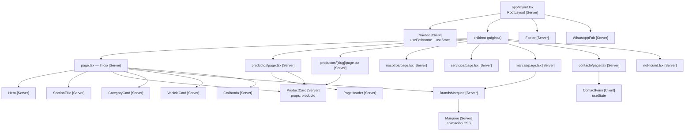

# IKOMI PERÚ — Réplica del sitio corporativo con Next.js

Réplica del sitio [ikomiperu.com](https://ikomiperu.com/) construida con **Next.js 16 (App Router)**,
**TypeScript** y **Tailwind CSS v4**. El objetivo no es una copia pixel a pixel, sino entender y
justificar cada decisión técnica: enrutamiento por archivos, navegación con `Link`, componentes
reutilizables, estrategia de estilos y animaciones.

---

## Requisitos

- Node.js 20 o superior
- npm (el proyecto usa `package-lock.json`; no usar pnpm ni yarn)

## Instalación y ejecución

```bash
npm install       # instala las dependencias
npm run dev       # servidor de desarrollo en http://localhost:3000
npm run build     # compila para producción (debe terminar sin errores)
npm run start     # sirve el build de producción
npm run lint      # ESLint
```

## Estructura del proyecto

```
src/
├── app/                     # Enrutamiento por archivos (App Router)
│   ├── layout.tsx           # Layout raíz: fuentes, Navbar, Footer, botón de WhatsApp
│   ├── page.tsx             # Inicio
│   ├── globals.css          # Tema único: colores, tipografías y animaciones
│   ├── not-found.tsx        # 404
│   ├── productos/           # /productos y /productos/[slug]
│   ├── nosotros/            # /nosotros
│   ├── servicios/           # /servicios
│   ├── marcas/              # /marcas
│   └── contacto/            # /contacto
├── components/              # Componentes reutilizables
│   ├── Navbar.tsx           # Client: navegación con usePathname y menú móvil
│   ├── Footer.tsx           # Server
│   ├── Hero.tsx             # Server: banner de portada
│   ├── SectionTitle.tsx     # Server: encabezado de sección
│   ├── ProductCard.tsx      # Server: recibe el producto por props
│   ├── ContactForm.tsx      # Client: formulario (solo interfaz)
│   ├── Marquee.tsx          # Server: marquesina de CSS puro
│   ├── BrandsMarquee.tsx    # Server: carrusel de marcas
│   ├── CategoryCard.tsx     # Server: tarjeta de sistema del vehículo
│   ├── VehicleCard.tsx      # Server: tarjeta de unidad
│   ├── PageHeader.tsx       # Server: cabecera de páginas interiores
│   ├── CtaBanda.tsx         # Server: banda de llamada a la acción
│   └── WhatsAppFab.tsx      # Server: botón flotante de WhatsApp
└── data/                    # Datos estáticos
    ├── productos.ts         # Catálogo de productos
    └── sitio.ts             # Marcas, sistemas, vehículos, contacto y textos
```

---

## Árbol de componentes

`[Server]` = se renderiza en el servidor (HTML directo, sin JavaScript extra).
`[Client]` = necesita JavaScript en el navegador (estado, hooks o eventos).



**Solo son Client Components `Navbar` y `ContactForm`**, porque son los únicos que necesitan estado
en el navegador: el `usePathname` para marcar el enlace activo y el `useState` para el menú y el
formulario. Todas las páginas y el resto de componentes se renderizan en el servidor.
El detalle está justificado en [`docs/DECISIONES.md`](docs/DECISIONES.md).

---

## Documentación del proyecto

| Documento | Contenido |
| :--- | :--- |
| [`docs/DECISIONES.md`](docs/DECISIONES.md) | Decisiones de configuración, enrutamiento, navegación, estilos e imágenes. |
| [`docs/BITACORA_IA.md`](docs/BITACORA_IA.md) | Bitácora de uso de IA y casos de código incorrecto detectados. |
| [`evidencias/`](evidencias/) | Capturas de build, responsive (375/768/1280) y del experimento de red. |

## Imágenes, favicon e iconos

- Las fotografías de productos, marcas y banners se sirven desde el CDN de `ikomiperu.com` con
  `next/image`, por eso `next.config.ts` permite ese dominio en `images.remotePatterns`.
- El favicon es el logo de IKOMI: está en `src/app/favicon.ico` y además se declara el PNG de 512 px
  en `metadata.icons`.
- Todos los iconos del sitio (ubicación, correo, teléfono, flechas y el botón de WhatsApp) vienen de
  `lucide-react`, así que todos tienen el mismo trazo y el mismo estilo.
